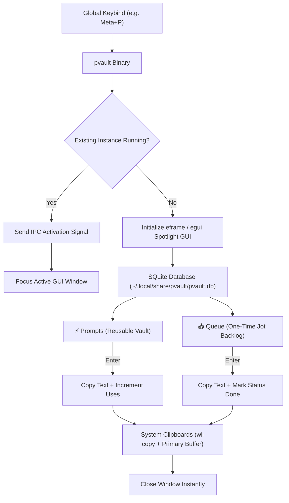

# pvault

A lightning-fast, keyboard-driven spotlight launcher built in Rust for managing and instantly retrieving developer prompts and backlog tasks.

Designed around a Linear / Apple Notes aesthetic, `pvault` eliminates context switching when interacting with coding agents and terminals. It runs in a compact floating window, copies text straight to system clipboards, updates usage metrics, and dismisses itself instantly.

---

## The Problem & The Solution

- **The Problem:** When working inside terminal agents or CLI environments, accessing frequent prompt templates or queueing one-time task ideas interrupts flow. Launching heavy Electron apps or navigating multi-pane TUIs requires switching windows, searching, copying, and manually exiting.
- **The Solution:** A native, zero-runtime-dependency Rust launcher mapped to a global shortcut (`Meta+P`). Press the keybind, fuzzy-search what you need, hit `Enter`, and return to your terminal with the text already copied to both the standard clipboard and Linux primary selection.

`pvault` unifies two complementary workflows:
1. **⚡ Prompts (Vault):** Evergreen, reusable prompts (code review templates, design frameworks, refactoring instructions) tracked by usage frequency and favorites.
2. **📥 Queue (Jot):** Disposable, one-time task backlog items. When consumed with `Enter`, tasks are automatically marked done and cleared from your queue.

---

## Architecture & Data Flow



### Technology Stack

| Layer | Technology | Purpose |
| :--- | :--- | :--- |
| **Language & Toolchain** | Rust (Edition 2021) | Safe, high-performance static binary |
| **UI Framework** | `eframe` / `egui` (0.29) | Immediate mode, sub-millisecond GUI rendering |
| **Graphics Backend** | `glow` (Wayland / X11) | Lightweight hardware-accelerated rendering |
| **Database & Search** | `rusqlite` (0.31, bundled) + `fuzzy-matcher` | Zero-dependency ACID local storage + Skim fuzzy filtering |
| **Clipboard Integration**| `arboard` (3.4) + `wl-copy` | Dual sync to standard clipboard & Linux primary selection |
| **IPC** | `interprocess` (2.2) | Fast local socket signaling for single-instance toggle |

---

## Directory Structure

```text
/home/barath/Documents/Rust/pvault/
├── Cargo.lock          # Pinned dependency lockfile
├── Cargo.toml          # Package metadata and feature declarations
├── jot.rs              # Reference implementation for backlog task schema
└── src/
    └── main.rs         # Unified launcher GUI, SQLite data store, and IPC daemon
```

---

## Keyboard Controls & Navigation

### Search & List Mode

| Keybinding | Action |
| :--- | :--- |
| **`Type text`** | Real-time fuzzy search across titles and prompt bodies |
| **`↑` / `↓`** (or **`Ctrl+K` / `Ctrl+J`**) | Move selection through prompts/ideas with auto-centering |
| **`Tab`** | Switch modes between **⚡ Prompts** and **📥 Queue (Jot)** |
| **`Enter`** (in Prompts) | Copy prompt to clipboard, increment usage counter, and close |
| **`Enter`** (in Queue) | **Copy task to clipboard, mark task as done, and close** |
| **`Ctrl + F`** | Toggle favorite (`★` / `☆`) on selected prompt |
| **`Ctrl + P`** (in Queue) | Cycle project filter (`all`, `<project_name>`) |
| **`Ctrl + E`** | Edit selected prompt or task |
| **`Ctrl + D`** | Delete selected prompt or task from database |
| **`Ctrl + N`** | Open inline form to create a new prompt or jot an idea |
| **`Esc`** or **Focus Loss** | Immediately close window |

### Creation & Edit Mode (`Ctrl + N` / `Ctrl + E`)

| Keybinding | Action |
| :--- | :--- |
| **`Enter`** (in Title / Project field) | Advance focus directly into the multiline content editor |
| **`Enter`** (in Content editor) | Insert a standard newline |
| **`Ctrl + S`** or **`Ctrl + Enter`** | Save changes to SQLite database and return to list |
| **`Esc`** | Cancel changes and return to list |

> [!NOTE]
> When creating or editing prompts, the window automatically pins to `AlwaysOnTop` and disables auto-close on focus loss, allowing you to freely reference browsers or editors without dismissing the form.

---

## Database & Storage

All data is stored locally in SQLite in WAL mode:

```text
~/.local/share/pvault/pvault.db
```

### Schema

```sql
CREATE TABLE IF NOT EXISTS prompts (
    id TEXT PRIMARY KEY,
    title TEXT NOT NULL,
    text TEXT NOT NULL,
    fav INTEGER NOT NULL DEFAULT 0,
    uses INTEGER NOT NULL DEFAULT 0,
    created INTEGER NOT NULL,
    updated INTEGER NOT NULL
);

CREATE TABLE IF NOT EXISTS ideas (
    id INTEGER PRIMARY KEY AUTOINCREMENT,
    body TEXT NOT NULL,
    project TEXT NOT NULL DEFAULT '',
    status TEXT NOT NULL DEFAULT 'inbox',
    created_at TEXT NOT NULL
);
```

### Automatic Migration
On first launch, `pvault` automatically detects and imports legacy prompts from `~/.config/pvault/prompts.json` or `~/.config/prompt-vault/prompts.json`, and backlog tasks from `~/.local/share/jot/jot.db`.

---

## Prerequisites & Installation

### Requirements
- **Rust Toolchain:** Stable Rust (`cargo`, `rustc` 1.80+)
- **Display Server:** Wayland or X11 (tested natively on KDE Plasma Wayland)
- **Wayland Utilities:** `wl-clipboard` (provides `wl-copy`)

```bash
# Arch Linux / CachyOS / Manjaro
sudo pacman -S wl-clipboard
```

### Build & Install

```bash
# Clone the repository
git clone git@github.com:3DBarath/pvault.git
cd pvault

# Compile optimized release binary
cargo build --release

# Install to user binary path
mkdir -p ~/.local/bin
cp target/release/pvault ~/.local/bin/pvault-gui
```

---

## Global Shortcut Setup (KDE Plasma Wayland)

1. Open **System Settings** $\rightarrow$ **Shortcuts** $\rightarrow$ **Custom Commands**.
2. Click **Add New** $\rightarrow$ **Command**.
3. Configure:
   - **Name:** `Prompt Vault`
   - **Command:** `~/.local/bin/pvault-gui`
   - **Trigger Shortcut:** `Meta + P` (or your preferred key combination).
4. Click **Apply**.

Now pressing your shortcut opens `pvault` instantly. Press `Enter` on any prompt, and paste (`Ctrl+Shift+V` or middle-click) directly into your editor or agent.
